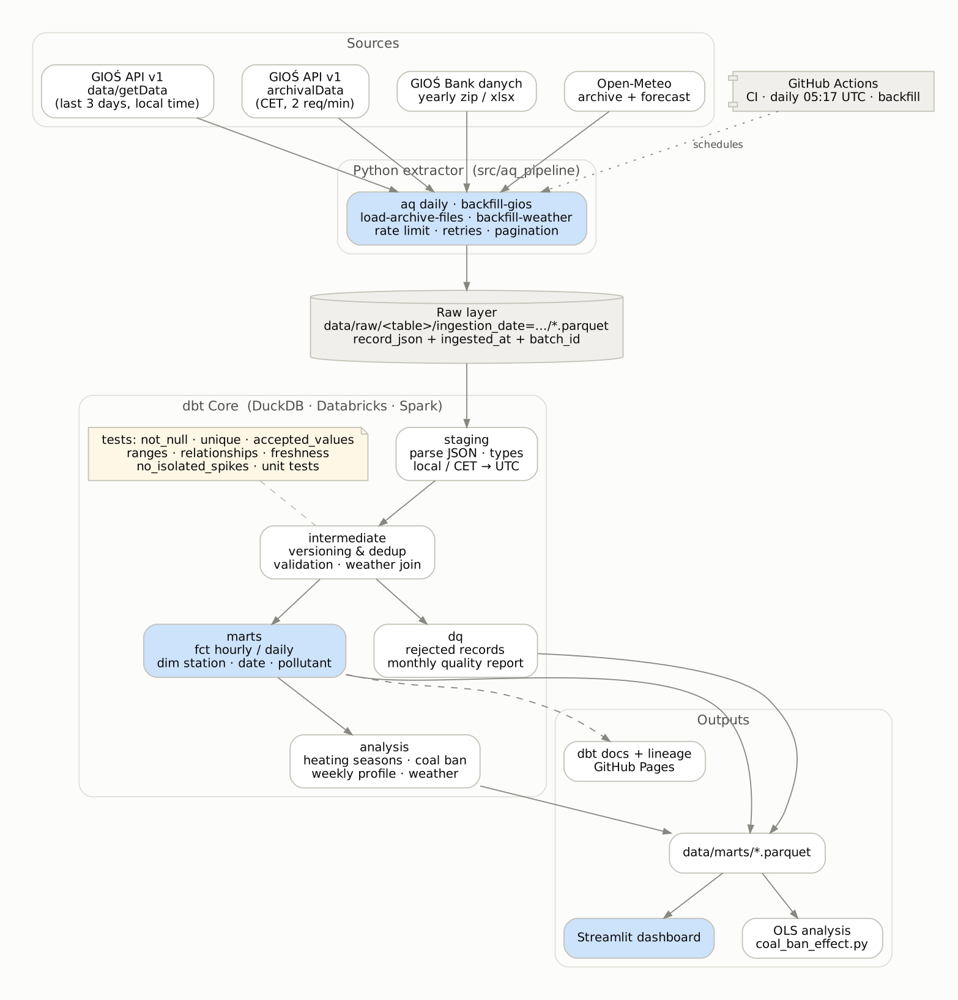
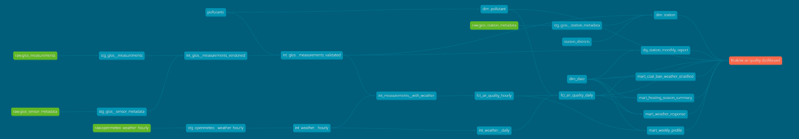
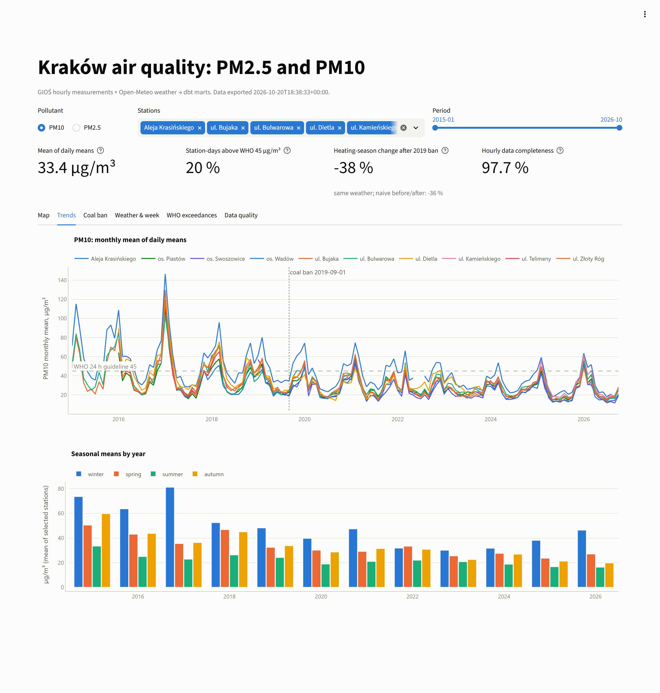
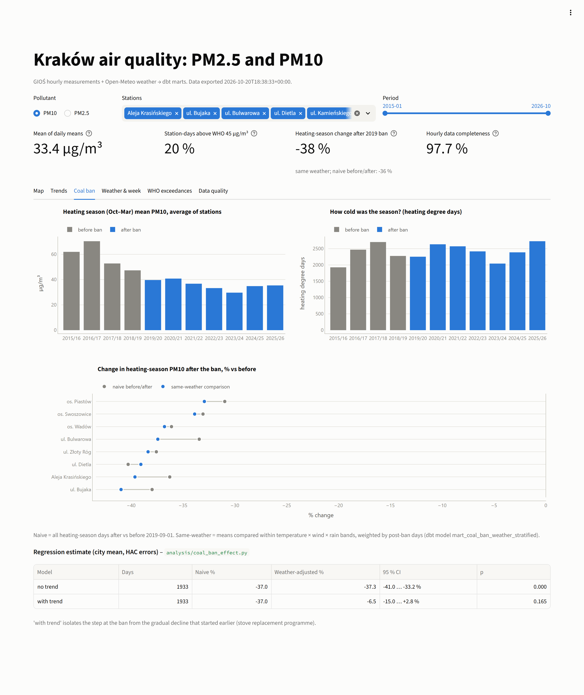
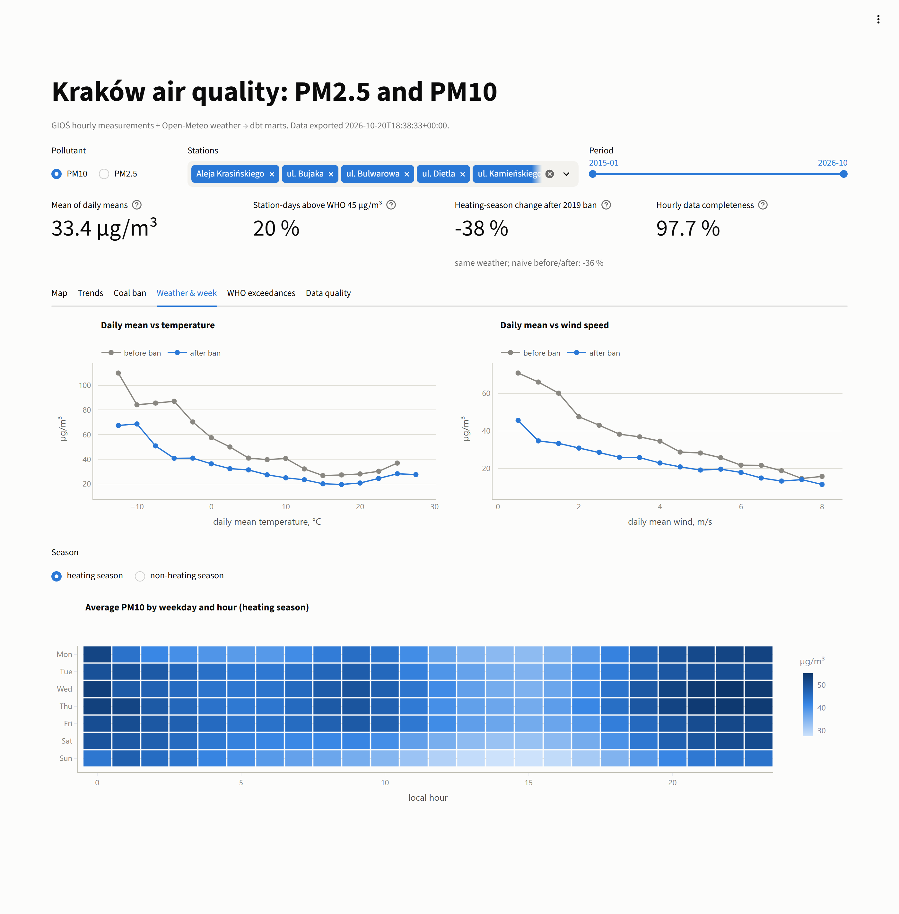
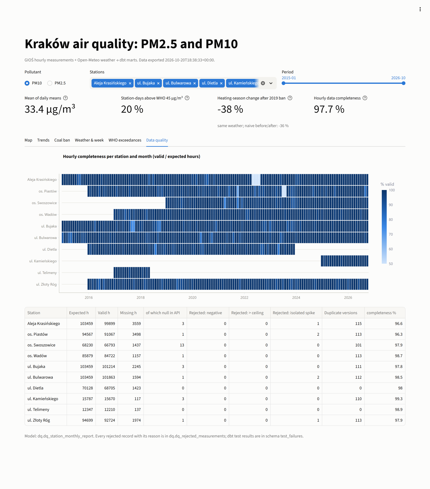

# Kraków air quality pipeline


Kraków's winter smog is famous well beyond Poland, and in September 2019 the city banned
burning coal and wood in homes. I wanted to check whether that ban actually
shows up in the measurements, or whether the cleaner winters since then are mostly down
to mild weather. This repo is the pipeline I built to answer it: Python pulls hourly PM10
and PM2.5 from GIOŚ plus weather from Open-Meteo, dbt cleans and models it, GitHub Actions
runs it every morning, and a Streamlit dashboard shows the results.

> 🇵🇱 **Po polsku, w skrócie:** chciałem sprawdzić, czy zakaz palenia węglem w Krakowie
> z 2019 roku widać w danych, kiedy odejmie się wpływ pogody. Python pobiera pomiary
> GIOŚ (API i roczne archiwa) oraz pogodę z Open-Meteo, dbt czyści to i składa w model
> gwiazdy z testami jakości, GitHub Actions odpala całość codziennie, a dashboard
> w Streamlit pokazuje trendy, sezony, przekroczenia norm WHO i raport jakości danych.

## The question

How do PM2.5 and PM10 at Kraków's monitoring stations change with the season, the
weather and the day of the week? And is the solid-fuel ban (in force since
1 September 2019) visible once weather is taken into account?

The weather part is the reason this isn't a one-chart project. Cold, still days trap
smoke over the city, and several winters after 2019 were warm. Compare "before" with
"after" naively and you mostly measure the weather. So I compare days with similar
weather (a dbt mart) and also fit a regression that controls for it (Python).

## What I found

Heating seasons (October–March), city average, 2015 – October 2026 (about 980k station-hours). Full output with
confidence intervals is in [docs/analysis/coal_ban_effect.md](docs/analysis/coal_ban_effect.md).

| | PM10 | PM2.5 |
|---|---:|---:|
| Plain before/after difference | −37 % | −40 % |
| Same weather, month and weekday | −37 % | −40 % |
| Same, plus a linear trend: the "step" at September 2019 | −6.5 % (p = 0.17) | +1.6 % (p = 0.77) |

My reading: heating-season PM got roughly 40 % lower, and weather doesn't explain that
away (the adjusted number barely moves from the plain one). But there's no sudden drop when the ban started. The improvement looks gradual,
which fits what I know about Kraków: the city paid people to replace coal stoves for years
before 2019, so by the time the ban came in most of the work was already done. I can't
separate the ban from everything else that changed in those years (traffic, regional
emissions, COVID in 2020), so treat this as "consistent with" rather than "caused by".

## Status

| Part | State |
|---|---|
| Extraction (GIOŚ API v1, yearly packages, Open-Meteo) | First full run on real data on 2026-10-20: 2015–2025 from the yearly packages, 2026 and one gap in 2022 from the archival API, daily increment from the current API. Unit tests use mocked responses. |
| dbt on DuckDB | `dbt build` passes: 20 models, 111 data tests, 5 unit tests |
| dbt on Spark (Databricks SQL dialect) | Builds and passes unit tests on local Spark 3.5, results match DuckDB; checked in CI |
| Databricks Job / Asset Bundle | Written but not deployed yet, see [databricks/README.md](databricks/README.md) |
| Screenshots | Real GIOŚ data |

## Architecture



| Layer | Where | What happens |
|---|---|---|
| Sources | GIOŚ API v1, GIOŚ yearly packages, Open-Meteo | Hourly PM10/PM2.5 per station, hourly weather for Kraków |
| Extraction | `src/aq_pipeline` (`aq` CLI) | Rate limiting per endpoint group, retries with backoff, pagination, resumable backfill |
| Raw | `data/raw/<table>/ingestion_date=…/*.parquet` | Append-only. Every record is kept exactly as received (JSON) with `ingested_at`, `batch_id`, `source_system` and request parameters |
| Staging | `dbt/models/staging` | JSON parsing, types, Polish field names → English, all timestamps to UTC |
| Intermediate | `dbt/models/intermediate` | Picking one version of each hour across sources, validation, hourly/daily weather, join |
| Marts | `dbt/models/marts/core` | `fct_air_quality_hourly`, `fct_air_quality_daily`, `dim_station`, `dim_date`, `dim_pollutant` |
| Data quality | `dbt/models/marts/quality` | `dq_rejected_measurements`, `dq_station_monthly_report` |
| Analysis | `dbt/models/marts/analysis`, `analysis/` | Heating seasons, same-weather comparison, weekly profile, weather response, regression |
| Serving | `data/marts/*.parquet`, Streamlit, GitHub Pages | Dashboard and dbt docs with lineage |

I kept the raw layer "dumb" on purpose. If GIOŚ renames a field, ingestion keeps working
and I only fix one staging model, and I can always re-parse old downloads.

## Data sources

| Source | Used for | Notes |
|---|---|---|
| [GIOŚ API v1](https://powietrze.gios.gov.pl/pjp/content/api) `data/getData` | Daily increment | Last ~3 days, not yet verified by GIOŚ, Polish local time. The old `/pjp-api/rest/` endpoints were switched off on 2025-06-30 |
| GIOŚ API v1 `archivalData/getDataBySensor` | Current year, gaps in the packages | 2 requests per minute, fixed UTC+1 |
| [GIOŚ Bank danych pomiarowych](https://powietrze.gios.gov.pl/pjp/archives) | 2015–2025 | One zip per year (~60 MB), an Excel file per pollutant, UTC+1 |
| GIOŚ `metadata/*`, `station/*` | Station dimension, sensor ids | Refreshed at most once a week |
| [Open-Meteo](https://open-meteo.com/) archive + forecast | Weather | Reanalysis where available; the newest days come from the forecast model and get replaced later |

GIOŚ data: © Główny Inspektorat Ochrony Środowiska, CC BY 4.0. Weather: Open-Meteo.com, CC BY 4.0.

## Things the real data taught me

Before the first real run I only had the official API descriptions and synthetic data.
Running it against the live services turned up a few things the docs don't tell you:

* **Three sources, two time conventions.** The current API reports Polish local time
  (with summer time), while the archival API and the yearly files use fixed UTC+1. I
  checked it directly: archival API values match the yearly file hour for hour, and the
  newest current reading carries the local clock hour. Everything gets converted to UTC
  in staging.
* **Excel timestamps drift.** In the yearly packages the hours are stored as floats, and
  by the end of December they're off by about 44 seconds (`2015-12-31 23:00:43.785`). The
  parser rounds them to the hour, otherwise the joins with weather quietly fail.
* **Not every PM sensor is hourly.** 7 of the 17 PM sensors in Kraków are manual
  (filters weighed in a lab, one value per day). The current API answers them with
  HTTP 400 and error code `API-ERR-100003`, which would have killed the whole daily run.
  They're now skipped.
* **A whole year missing in one file.** The 2022 package has no hourly data at all for
  Al. Krasińskiego, one of the busiest stations. The archival API does have it, so I added
  `--sensor-id` to the backfill command to fill just that gap.
* **The documented 366-day window doesn't really work.** Asking the archival API for a
  full year timed out after two minutes. One month per request comes back in ~30 seconds.

## Running it

```bash
git clone https://github.com/KarolGucwa/krakow-air-quality && cd krakow-air-quality
python -m venv .venv && source .venv/bin/activate
make install              # requirements + the `aq` CLI
make deps                 # dbt packages (dbt_utils)
```

The repo already includes the raw layer (`data/raw`, about 9 MB) and the mart exports, so
`make dashboard` works straight after cloning.

### Offline demo (synthetic data, about a minute)

```bash
make demo                 # generate raw layer → dbt build → export marts → regression
make demo-dashboard       # http://localhost:8501, with a red "synthetic data" banner
```

The generator (`src/aq_pipeline/sample_data.py`) writes records shaped like the real ones
and deliberately breaks them: overlapping sources, repeated snapshots, outages, nulls,
negative and absurd values, one-hour spikes. That's what the tests run on in CI.

### Rebuilding the real data from scratch

```bash
aq refresh-metadata                       # stations and sensors (~12 min, the API allows 2 requests/min)
aq backfill-weather --start 2015-01-01    # a few seconds

# 2015-2025: download the "Wyniki pomiarów z <rok> roku" zips from
# https://powietrze.gios.gov.pl/pjp/archives into data/landing/gios_archive/, then
aq load-archive-files                     # ~1.5 min, ~900k records
aq backfill-gios --start 2026-01-01       # current year, ~1 min per sensor-month, resumable
aq backfill-gios --start 2022-01-01 --end 2022-12-31 --sensor-id 2750 --sensor-id 2752   # the 2022 gap

make pipeline             # daily increment + dbt build + export + analysis
make dashboard
```

On Windows there's no `make`, so run the Makefile commands one by one (in PowerShell set
variables with `$env:NAME="value"`). One more Windows thing: Smart App Control blocked
pyarrow's Parquet module on my laptop, so all Parquet reading and writing goes through
DuckDB instead.

## dbt project

```
dbt/models
├── staging        stg_gios__measurements, stg_gios__station_metadata, stg_gios__sensor_metadata,
│                  stg_openmeteo__weather_hourly
├── intermediate   int_gios__measurements_versioned → int_gios__measurements_validated,
│                  int_weather__hourly, int_weather__daily, int_measurements__with_weather
└── marts
    ├── core       fct_air_quality_hourly, fct_air_quality_daily, dim_station, dim_date, dim_pollutant
    ├── quality    dq_rejected_measurements, dq_station_monthly_report
    └── analysis   mart_heating_season_summary, mart_coal_ban_weather_stratified,
                   mart_weekly_profile, mart_weather_response
```



`make docs` builds the documentation with lineage (`dbt/target/static_index.html`), and the
daily workflow publishes it to GitHub Pages.

### How the messy parts are handled

* **The same hour arrives several times**: three overlapping daily snapshots, then the
  archival API, then the verified yearly package. `int_gios__measurements_versioned`
  keeps one version, verified sources first, then the newest download. The losers aren't
  thrown away, they end up in `dq_rejected_measurements` as `superseded_duplicate`.
* **Validation** (`int_gios__measurements_validated`) marks each hour as `missing_value`,
  `negative_value`, `out_of_range` (ceilings per pollutant in `seeds/pollutants.csv`) or
  `isolated_spike` (a single hour far above both neighbours). I set the ceilings high on
  purpose. PM10 above 300 µg/m³ really happens in a Kraków winter, and I didn't want to
  delete the worst smog days as "errors". Only valid hours reach the fact tables, and
  every rejected one can be traced.
* **The 18-hour rule.** A daily mean only counts with at least 18 valid hours (75 %).
  Without it, a day with 5 hours of data could "exceed" the WHO limit, and gaps would
  change the exceedance counts.

### Tests

| Kind | Examples |
|---|---|
| Built-in | `not_null`, `unique`, `accepted_values`, `relationships` (facts → dimensions) |
| `dbt_utils` | `unique_combination_of_columns` for every fact grain, `accepted_range` for concentrations, coordinates, weather and completeness |
| Source freshness | warn after 30 h, error after 54 h |
| Custom generic | `no_isolated_spikes` (error on facts, warning on raw staging), `max_hourly_change` (warning), both in `dbt/tests/generic` |
| Singular | daily fact matches the hourly one; nothing from the future; exceedances only on complete days; DQ report adds up (valid + rejected + missing = expected) |
| Unit tests | time-zone conversion (summer, winter, the repeated autumn hour), source priority, each validation rule, the 18-hour rule |

Failing rows are stored in the `test_failures` schema (`store_failures`), so I can query
them instead of reading logs. On the real data the warnings are mostly what you'd expect:
a handful of genuine one-hour spikes, smog episodes where PM10 jumps by more than
250 µg/m³ in an hour, and station-months with low completeness (new stations, outages).

### Data-quality report

`dq_station_monthly_report` has one row per station, pollutant and month: expected
hours, valid hours, missing hours, rejected hours by reason, duplicates and completeness.
It's the "Data quality" tab in the dashboard, and it's how I spotted the 2022 gap.

## Coal-ban analysis in more detail

Both estimates use heating-season days only (October–March).

1. **Same-weather comparison** (`mart_coal_ban_weather_stratified`, dbt): days are grouped
   into temperature × wind × rain bands, the before/after means are compared within each
   band, and the bands are weighted by the number of post-ban days.
2. **Regression** (`analysis/coal_ban_effect.py`):
   `log(PM) ~ after_ban + temperature + temperature² + log(wind) + rain day + humidity + month + weekday`,
   with Newey-West standard errors because consecutive days are correlated. I run it with
   and without a linear trend. Without the trend it answers "how much cleaner is it at
   equal weather?", with the trend it asks "was there a jump at the ban itself?".

The obvious next step is a difference-in-differences comparison with towns where the ban
didn't apply in 2019. I haven't done it yet.

## Dashboard

`dashboard/app.py` (Streamlit + Plotly) only reads `data/marts/*.parquet`, so it runs
for free on [Streamlit Community Cloud](https://streamlit.io/cloud): new app → this repo →
`dashboard/app.py`. The daily workflow refreshes those files, so the deployed app stays
up to date without me touching it.

Tabs: station map · monthly trends with the ban date and the WHO line · seasonal means by
year · heating seasons before and after the ban · naive vs same-weather change per
station · PM against temperature and wind · weekday × hour heatmap · days above the WHO
24-hour guideline · data completeness.

| | |
|---|---|
|  |  |
|  |  |

## Scheduling (GitHub Actions)

| Workflow | Trigger | Steps |
|---|---|---|
| `ci.yml` | push, PR | ruff, pytest, `dbt build` on synthetic data (DuckDB) and on local Spark |
| `daily_pipeline.yml` | every day 05:17 UTC, manual | `aq daily` → commit raw → freshness → `dbt build` → export marts → regression → commit marts → dbt docs to Pages |
| `backfill.yml` | manual | archival API or weather backfill, resumable, commits after every run |

Raw data is committed before dbt runs, so a failing test never costs me downloaded data.
The two data workflows share a concurrency group and never write at the same time.

One-time GitHub setup: *Settings → Actions → General → Workflow permissions → Read and
write*, and *Settings → Pages → Source: GitHub Actions*.

## Databricks version

A lot of data job ads in Kraków mention Databricks, so I made the same project run there
too. [databricks/](databricks/) has an Asset Bundle for the Free Edition: a PySpark
notebook loads the raw Parquet into Delta tables, then the same dbt models run through
`dbt-databricks` as a Databricks Job. The engine-specific SQL (JSON extraction, time
zones, weekday numbers, safe casts) sits in dispatched macros in `dbt/macros/cross_db.sql`,
and CI builds the whole project on Spark so I notice when I write DuckDB-only SQL.

## Open questions

* **The repeated autumn hour.** When clocks go back, local time has the same hour twice.
  It maps to one UTC hour and one reading is dropped as a duplicate (unit test
  `staging_autumn_dst_hour_maps_to_one_utc_hour`). DuckDB and Spark resolve that hour
  differently, so this one test runs on DuckDB only. It only affects the last three days
  of data anyway: the yearly files don't have the problem and take priority.
* **Districts** (`dbt/seeds/station_districts.csv`) come from reverse geocoding the
  station coordinates against OpenStreetMap. Al. Krasińskiego sits right on the border
  between Zwierzyniec and Stare Miasto, and OSM puts it in Zwierzyniec.
* **`station/findAll` field names** aren't documented, so the extractor matches them
  loosely (`find_field`). Everything dbt relies on is documented.
* **Data before 2015.** Older packages use older station codes. I start the analysis at
  2015 and haven't mapped the old codes yet.

## Repository layout

```
├── src/aq_pipeline/        extraction package and the `aq` CLI
├── tests/                  pytest for the extractor
├── config/pipeline.yml     city, pollutants, endpoints, rate limits, weather point
├── dbt/                    dbt project (models, macros, seeds, tests, profiles)
├── analysis/               regression for the ban effect
├── dashboard/app.py        Streamlit dashboard
├── databricks/             Asset Bundle + PySpark notebooks
├── scripts/                screenshots, Spark table registration
├── data/raw/               raw layer (committed by the daily workflow)
├── data/marts/             Parquet exports for the dashboard
├── docs/                   architecture diagram, screenshots, analysis output
└── .github/workflows/      CI, daily pipeline, backfill
```

## License

MIT, see [LICENSE](LICENSE).
